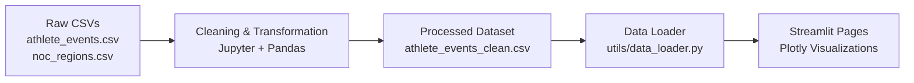

<div align="center">

# 🏅 Olympics Data Explorer

**Interactive analytics dashboard for 120 years of Olympic history (1896–2016)**


[**🚀 Live Demo**](https://olympics-data-explorer-dznxkcahqebghbhaiuhmjm.streamlit.app/) &nbsp;|&nbsp; [**📓 EDA Notebooks**](analysis/) &nbsp;|&nbsp; [**🐞 Report Issue**](https://github.com/D-sasmita/olympics-data-explorer/issues)

</div>

---

## 📌 Overview

End-to-end data project: raw CSV ingestion → cleaning and transformation → processed dataset → multi-page interactive dashboard.

Built on the **120 Years of Olympic History: Athletes and Results** dataset (athletes, teams, sports, events, editions, medals).

## 📸 Preview

<!-- Add screenshots to /assets and update the paths below -->
| Dashboard | Medal Analysis |
|:---:|:---:|
|  |  |

| Country Comparison | Data Explorer |
|:---:|:---:|
|  |  |

## ✨ Features

| Module | Description |
|---|---|
| **Olympics Dashboard** | Participation trends, medal distribution, top-performing regions |
| **Medal Analysis** | Medal tallies, overall statistics, country-wise and athlete-level results |
| **Country Comparison** | Compare countries/regions across medal counts and historical trends |
| **Data Explorer** | Filter by athlete, year, season, region, sport, gender, medal type |
| **EDA Notebooks** | Documented exploratory analysis and data cleaning |

## 🔄 Data Pipeline



| Stage | Location | Purpose |
|---|---|---|
| Ingest | `data/raw/` | Source athlete events and NOC region mapping |
| Transform | `analysis/` | Cleaning, validation, and EDA in notebooks |
| Store | `data/processed/` | Analysis-ready cleaned dataset |
| Serve | `utils/data_loader.py` | Single shared loading layer for all pages |
| Visualize | `app.py`, `pages/` | Interactive multi-page dashboard |

## 🛠️ Tech Stack

| Category | Tools |
|---|---|
| Language | Python 3.11 |
| Data Processing | Pandas, NumPy |
| Visualization | Plotly |
| Web App | Streamlit |
| Analysis | Jupyter Notebook |
| Environment | Conda, pip |
| Deployment | Streamlit Community Cloud |

## 📂 Project Structure

```
olympics-data-explorer/
├── analysis/
│   ├── eda.ipynb
│   └── olympics_data_analysis.ipynb
├── assets/                  # screenshots
├── data/
│   ├── raw/                 # source CSVs (git-ignored)
│   └── processed/           # cleaned dataset (git-ignored)
├── pages/
│   ├── 1_Medal_Analysis.py
│   ├── 3_Country_Comparison.py
│   └── 4_Data_Explorer.py
├── utils/
│   └── data_loader.py
├── app.py
├── requirements.txt
└── README.md
```

## ⚙️ Getting Started

**1. Clone**
```bash
git clone https://github.com/D-sasmita/olympics-data-explorer.git
cd olympics-data-explorer
```

**2. Create environment**
```bash
conda create -n olympics python=3.11
conda activate olympics
```

**3. Install dependencies**
```bash
pip install -r requirements.txt
```

**4. Add data**

Download the dataset and place files at:

- `data/raw/athlete_events.csv`
- `data/raw/noc_regions.csv`
- `data/processed/athlete_events_clean.csv` (generate via the notebooks in `analysis/`)

> Raw and processed CSVs are excluded from Git. Obtain or generate them locally before running the app.

**5. Run**
```bash
streamlit run app.py
```

## 🗺️ Roadmap

- [ ] Additional historical comparisons and insights
- [ ] Richer data storytelling visuals
- [ ] Automated data validation checks on the processed dataset

## 👩‍💻 Author

**Sasmita Das**

[](https://github.com/D-sasmita)

---

<div align="center">⭐ If you found this useful, consider starring the repo.</div>
